# BidCopilot 产品说明

- 版本：v1.6（2026-11-19 修订：按 BSL 1.1 社区版口径重述——多租户运营/套餐计量/平台治理划为企业版闭源能力；help 20 章、业务表 78 张、后端 982 passed/2 skipped、前端 20 文件/69 用例；报价单闭环与成本参数配置、审计链修复为社区版能力；规则数量以当前规则包为准）
- 用途：对外宣贯 / 内部产品培训
- 延伸阅读（交付包其他文档）：[交付文档](2026-10-24-bidcopilot-delivery-report.md)（架构与验收）、[API 参考](2026-10-24-bidcopilot-api-reference.md)（集成）、[运维手册](2026-10-24-bidcopilot-ops-runbook.md)（部署运营）、[数据库参考](2026-10-24-bidcopilot-database-reference.md)（结构）、[开发交接手册](2026-10-24-bidcopilot-dev-handbook.md) / [详细设计文档](2026-10-24-bidcopilot-detailed-design.md)（接手开发）
- 产品形态：可私有化部署的 AI 招投标工作台
- 演示入口（公开只读）：
  - 平台用户视角：https://bidcopilot-demo-byz953f82hk.qoder.zone/?role=user
  - 管理员视角：https://bidcopilot-demo-byz953f82hk.qoder.zone/?role=admin
- 说明：演示站复刻真实界面，数据为示例，不提供登录或实时 AI 调用；真实系统需私有化部署。
- 商机数据网关（KeepRisk）开通：联系 [github.com/xrzlizheng](https://github.com/xrzlizheng)——演示站不含商机数据，真实商机需私有化部署并配置网关 AppCode；解析/生成/合规/合同审查无需网关。

---

## 一、产品定位（对外宣贯）

### 1.1 一句话定义

BidCopilot 是面向投标企业的 AI 招投标工作台：把真实商机、招标文件、企业资产、标书生产、合规检查与结果复盘串成一条可追溯的链路，让每一份标书“有据可依”。

### 1.2 解决什么问题

| 痛点 | 现状 | BidCopilot 的做法 |
|---|---|---|
| 商机获取靠人盯 | 多平台、多口径，遗漏与重复并存 | 机会中心统一接入 KeepRisk 与联网检索，机会同步、收藏、转项目，数据接口与网络线索分源可追溯 |
| 招标文件读不完 | 废标条款、评分项、资格要求散落在正文与表格 | 规则解析 docx/pdf/扫描件，输出约束集并保留原文位置 |
| 投不投靠拍脑袋 | 资格、业绩、预算、风险缺少统一口径 | 评分矩阵 + 资格预审 + Bid-No-Bid，缺证据输出 UNKNOWN 而非伪造通过 |
| 标书生产重复劳动 | 复制粘贴、格式反复调、事实无人核对 | 结构/格式模板 + 规则或 LLM 生成 + 主张级事实核查 + 格式/暗标导出 |
| 合规靠人肉检查 | 暗标泄露、格式不符、无源数字难发现 | 29 条确定性规则 + 租户策略，扫描结果带位置与整改建议 |
| 复盘不沉淀 | 赢率、失标原因、成本无账可查 | 结果复盘与赢率、数据成本台账、源健康与调用明细 |

### 1.3 目标客户与角色

- 目标客户：系统集成商、工程承包商、货物供应商、政务/医疗/教育行业投标团队。
- 典型角色：
  - 企业管理员：租户、用户、角色、合规策略、模型配置。
  - 投标负责人：机会筛选、Bid-No-Bid、项目推进、结果复盘。
  - 标书工程师：解析、模板、章节生成与编辑、材料补充。
  - 合规/法务：合规预检、findings 处置、暗标与格式把关。

### 1.4 差异化价值

1. **证据溯源**：事实核查按金额/日期/比例/工期/标准逐条匹配来源，无源主张标红，不把“看起来合理”当事实。
2. **确定性合规**：29 条规则覆盖暗标、格式、资格、证据、清单、时间、空章节、项目一致性、跨章节数值一致性、跨章节重复、知识库相似度、多标包未指定包件、未处理响应条目、报价异常、工作量成本与保证金上限；规则引擎不调用 LLM。
3. **不伪造通过**：资格缺证据输出 UNKNOWN；AI 评标不允许编造高分；LLM 未配置时明确失败，不静默降级。
4. **数据可对账**：KeepRisk 每次调用写入成本台账，保留 orderNo/charge，失败不降级为空列表。
5. **私有化与多租户**：租户隔离、RBAC、审计哈希链、会话失效、密钥不入库；支持 Docker Compose / Helm / 离线包。

---

## 二、产品全景

### 2.1 能力地图

| 模块 | 核心能力 | 用户价值 | 状态 |
|---|---|---|---|
| 机会中心 | KeepRisk 同步、商机订阅与定时同步、消息中心、联网情报检索、竞争情报、详情正文、收藏、转项目 | 统一情报入口，数据接口与联网线索分源可追溯 | 已实现 |
| 企业资产 | 资质/人员/业绩/信用、CSV/XLSX 导入、到期提醒、工商自检 | 资格与证据的真实来源 | 已实现 |
| 企业情报 | 工商/信用/股权关联/尽调；批量核验（≤100 家）、企业对比（2–5 家）、风险监控订阅；资产=工商自检、商机=采购人、项目=投标主体、合同=相对方 | 投前尽调与关联核验，风险与依据可追溯 | 已实现 |
| 版本形态 | 社区版（BSL 1.1）单企业自部署不限量；企业版（商业授权）提供多租户运营、套餐计量与平台治理 | 分层交付 | 社区版已实现；企业版闭源 |
| 交标回执 | 记录递交时间/平台/回执号并冻结交标自查快照；人工确认，不自动受理 | 递交动作可追溯 | 已实现 |
| 知识库冷启动 | 多份历史标书批量入库并自动切片；不自动生成模板 | 新租户快速建立可召回素材 | 已实现 |
| 交付品牌 | 导出件内嵌投标企业自身名称（`Company.name`）+ 交付摘要（打印/PDF） | 以投标企业自身名义交付 | 已实现 |
| 文件体检 | 招标文件买方侧 10 类规则体检；跨投标人雷同自查（相似度+共同片段） | 投前/合规自查 | 已实现 |
| 企业知识库 | 多格式文档（docx/pdf/txt/md/xlsx/xlsm/pptx）、图片多选、元数据编辑、加权召回 | 产品资料/方案/案例/图片在生成时被调用 | 已实现 |
| 机会中心 · 联网情报 | DeepSeek/MiniMax 搜索网关、成本台账与审计 | 补充项目背景与企业情报线索，与数据接口商机同页分源 | 已实现；DeepSeek 通道已真实验收，MiniMax 通道待充值 |
| 招标解析 | docx/pdf/OCR、约束集、评分项、资格、时间、预算、清单、暗标 | 把招标文件变成结构化任务 | 已实现 |
| 决策 | 评分矩阵、资格预审、Bid-No-Bid | Go / Conditional Go / No-Go 可解释 | 已实现 |
| 报价决策 | 成本参数配置（三率/人力单价/目标净利率）、三档建议价（市场锚定/成本加成/底线与预算钳制）、价格带与敏感性、报价单生成与 DOCX 导出（不可变快照、明细合计校验、人民币大写） | 从「报多少」到「报价单交付物」 | 已实现 |
| 模板与技能 | 4 套结构模板、2 套格式模板、12 项技能目录 | 统一标书骨架与版式 | 已实现 |
| 标书生产 | 大纲、规则/LLM 生成、编辑、事实核查、审批 | 从空白到可交付正文 | 已实现 |
| 导出 | 普通 docx、暗标 docx、格式包 | 审批后交付，暗标清空元数据 | 已实现 |
| 合规预检 | 29 条规则、租户策略、findings、PDF/Excel 报告 | 提交前发现硬伤 | 已实现 |
| AI 评标 | 判别模型逐项评分、证据、缺口、需复核 | 模拟评委视角查漏补缺 | 已实现 |
| 合同运营 | 合同审查（切分/风险规则/三方对照）、LLM 深审（按次计费）、履约台账提醒、补充协议对照、租户自定义规则 | 中标后风险与履约不脱管 | 已实现 |
| 复盘与赢率 | 中标/未中标/流标、失标原因、赢率口径 | 用结果反哺下一次投标 | 已实现 |
| 数据运营 | 成本台账、orderNo/charge、源健康 | 数据成本可对账 | 已实现 |
| 治理 | 租户/RBAC（系统角色+自定义角色+部门作用域）、组织单元、审计链（v2 HMAC，断链可用 repair-audit-chain 受控修复）、token 失效、模型配置（租户/个人 BYOK 信封加密）、知识库 ACL、字段级脱敏、break-glass 调阅审批 | 私有化安全底座 | 已实现 |
| 使用帮助 | 产品内 `/help`：9 步主线、20 个模块章节、状态速查、FAQ、权限与边界说明；侧边栏按角色显示 | 降低培训成本，口径与当前页面/后端校验一致 | 已实现 |

### 2.2 端到端流程

```
机会同步 → 采购人/投标主体情报核验 → 转投标项目 → 上传招标文件 → 解析约束集
   → 评分矩阵 → 资格预审 → Bid-No-Bid
   → 召回企业知识（文档/图片）
   → 套用模板生成大纲 → 规则/LLM 生成章节
   → 事实核查（有源/无源） → 人工编辑 → 审批
   → 合规预检 + findings 处置 → 普通/暗标导出
   → 结果复盘 → 赢率与数据运营
```

### 2.3 界面概览

以下截图取自**真实产品演示环境**（2026-10-24 实测采集，单容器部署 + 演示租户数据），用于展示当前版本界面与信息层级。

**两种角色视角**（侧边导航按权限过滤，不同角色所见菜单不同）

- **业务视角**（投标负责人 / 标书工程师）：投标工作流菜单（指挥台、机会中心、投标项目、企业资产、企业知识库、模板与技能），不含运营与治理菜单。
- **治理视角**（企业管理员）：完整菜单，含数据运营、审计日志、合规策略、用户管理与 2026-10 新增的**权限治理**（部门、角色、字段脱敏与个人资源调阅审批）。

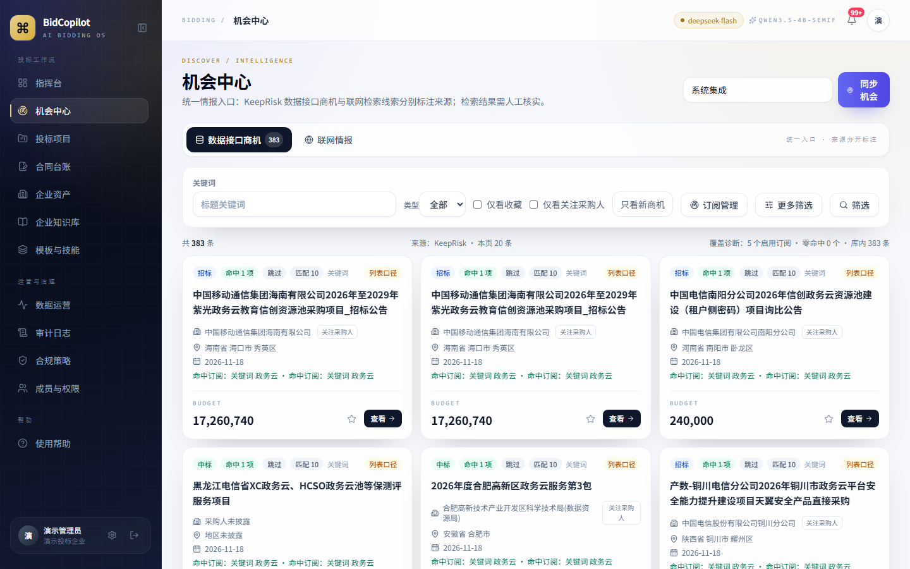

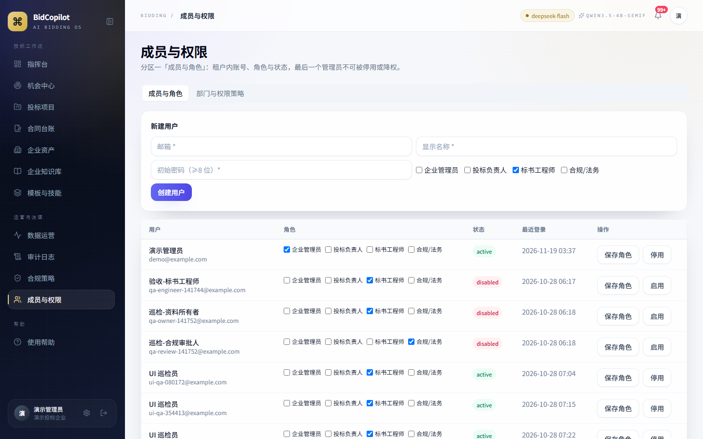

**指挥台：KPI、生产链路与 AI 引擎状态**

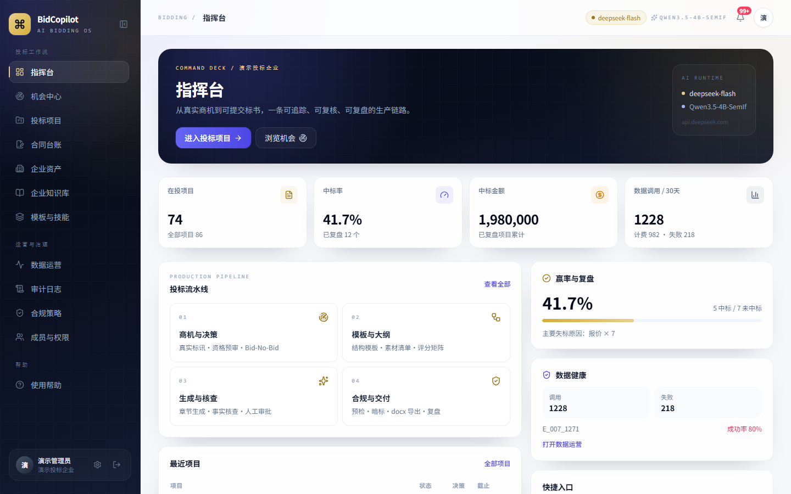

**投标项目：状态、决策与评分**

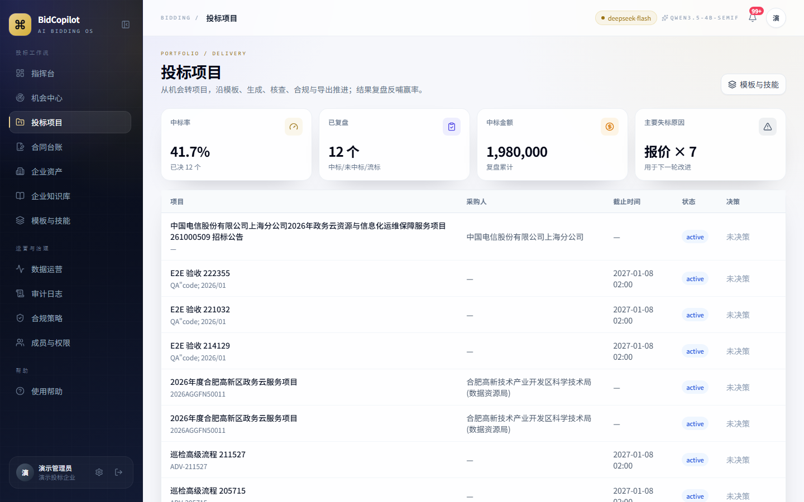

**模板与技能：结构模板、材料四态与技能目录**

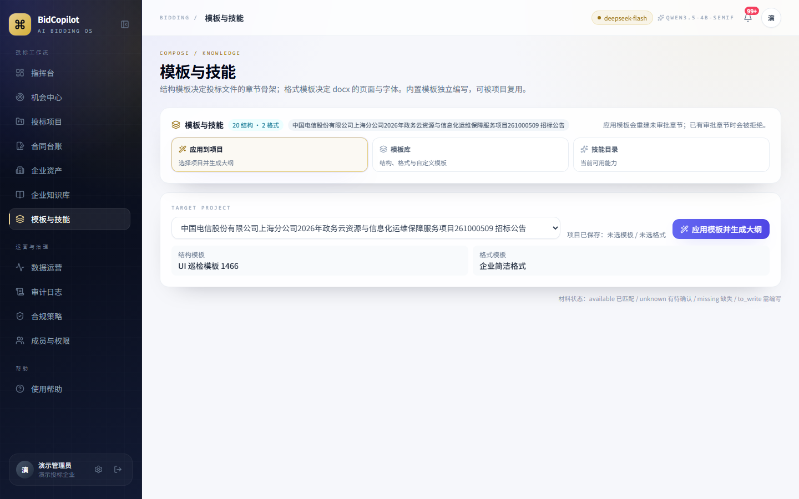

**合规预检：findings 列表、期望/实际与处置（截图采集于 2026-11-18；当前规则包 2026-10-25.4，29 条）**

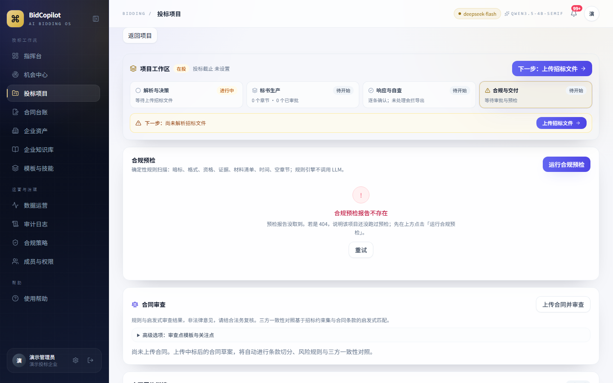

**企业资产：台账、有效期与到期提醒**

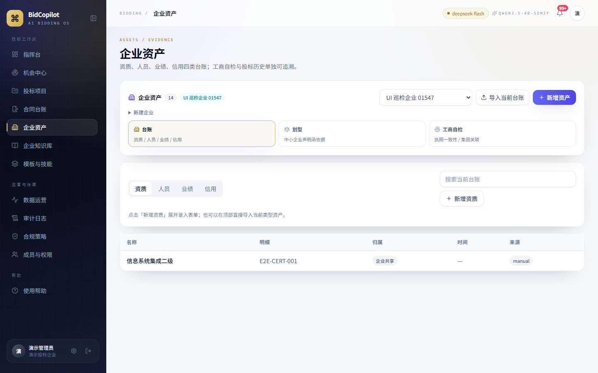

**用户管理：角色、状态与安全守卫**


---

## 三、核心功能详解

### 3.1 机会中心

- 定位：统一情报入口，不再单设「联网情报」菜单。页内按来源分为两个页签：
  - **数据接口商机**：按关键词同步 KeepRisk 商机，查看详情正文、采购人、地区、预算、发布时间，收藏并转为投标项目。
  - **联网情报**：调用 DeepSeek / MiniMax 搜索网关检索公开网络信息，补充项目背景、竞对与价格线索。
- 商机订阅与消息中心：把"人盯盘"变成回路。
  - 订阅：保存一组同步条件（关键词 / 类型 / 行业 / 预算 / 发布时间）+ 间隔分钟（下限 30 分钟，默认 60），可启停、删除、立即同步；每租户订阅数有上限（默认 10）。
  - 定时同步：容器内调度器每分钟检查到期订阅并复用同一套同步服务，逐条写入 `source_sync_runs`、成本台账与审计（`opportunity.sync_scheduled`）；多副本下用 PostgreSQL advisory lock 保证同一订阅只有一个进程在跑。
  - 消息中心：顶栏铃铛每 60 秒拉一次未读数；新增商机生成「订阅「X」新增 N 条商机」消息，同步失败生成「同步失败」消息并原样带上上游错误码与描述，不降级为空列表；支持全部已读。
  - 新商机口径：`rows_new` 由同步前对比本租户已有 `dedup_key` 得出（`rows_upserted` 在 upsert 下不区分新增）；列表「只看新商机」按 `created_after` 过滤最近 24 小时首次入库的商机。
- 筛选与排序：列表支持关键词、类型、收藏、地区、行业、预算区间、发布时间范围；排序支持发布时间（默认）、预算从高到低、订阅匹配度。
  - 匹配度是订阅偏好的启发式加权粗排（关键词/地区/行业各 2 分、预算区间 1 分），界面只显示「命中 N 项」并标注「启发式粗排 · 命中项来自启用订阅」，不输出百分数，也不宣称模型评分。
  - 没有启用中的订阅、或订阅未设置任何条件时，匹配度排序明确报错（422），不静默退化为默认排序。
- 自动匹配：`GET/PATCH /api/v1/opportunities/auto-match/settings` 配置自动匹配开关、间隔（下限 30 分钟）与匹配规则；`POST /api/v1/opportunities/auto-match/run` 手动触发一次全量匹配，命中的商机在列表标注匹配来源，并可一键转为项目（原仅列表页排序，2026-10-29 起补齐）。
- 关键口径：`uid` 不作为列表/详情过滤参数，但它是商机身份：存在时 `dedup_key = uid`；缺失时用 `title+采购人+发布时间(UTC)+类型+项目编号` 的哈希兜底，缺 uid 会在同步运行记录里计 `missing_uid` 警告但不丢数据；告警的 `code/message/field` 随运行记录落库（`warnings_json`），同步接口与界面可直接看到告警条数与代码。详情使用 ids + contentFlag；`bid_deadline` 不由 KeepRisk 提供。
- 产出：机会列表与详情、收藏关系、订阅与定时同步运行记录、消息中心条目、成本台账行、联网检索线索。
- 边界：两个来源在页签与结果区分别标注，互不混库；联网结果只作线索，不写入 KeepRisk 商机库，也不作为标书事实来源，必须人工核实。列表口径与全文口径在界面明确标识；源返回非 ok 状态原样透传，不降级为空列表。定时同步按次计费，间隔与订阅数都有上限约束。
- 兼容入口：旧 `/research` 地址 307 跳转到 `/opportunities?source=web`。

**机会中心：消息中心未读提醒与商机订阅**

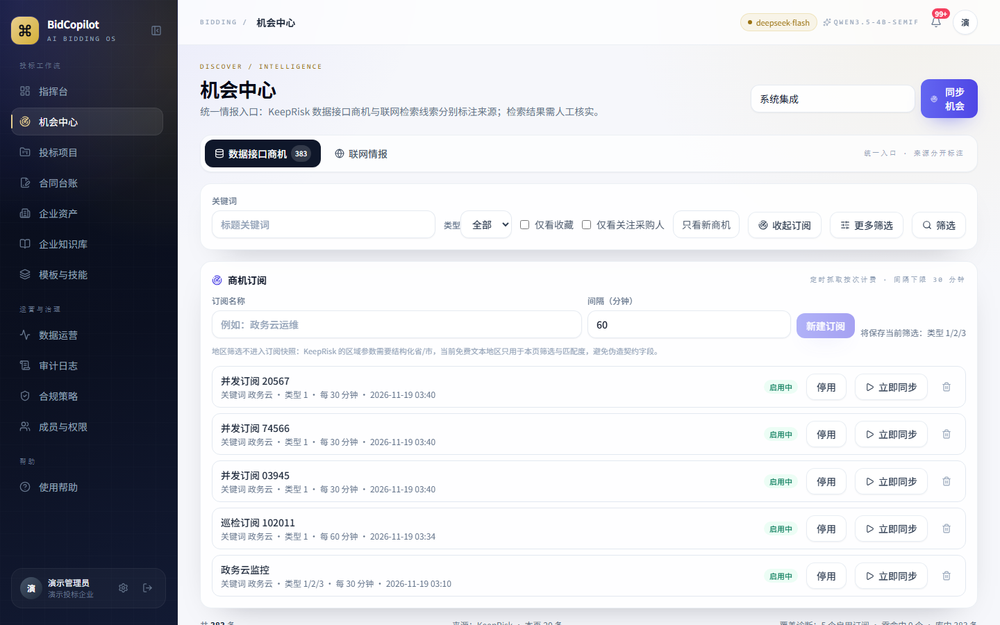

### 3.2 招标解析与约束集

- 支持：docx、pdf（文本层）、txt、md；图片与扫描 PDF 走 OCR；OCR 通道同时覆盖 MinerU 全集类型（pptx/xlsx/epub/html/ofd/doc/csv 等 24 种，本地解析器不认识的类型自动回落 OCR）。
- 输出：废标条款、评分项（含分值/类别/评分标准）、资格要求（等级/数量）、格式规则、时间节点、预算、材料清单、暗标要求，均带原文位置。
- 解析器：规则版本 `rules-v1.3`，已覆盖合并表头、合计行、序号列、Word 标题、暗标措辞等版式。
- 质量基线：19 份自编对抗金标语料，覆盖 docx/pdf/txt/md 四种版式，评分 54/54、资格 36/36、废标 22/22、预算与暗标 19 case 全对，四维度精确率与召回率均为 1.000。该基线不能替代客户真实标书。
- 本地 OCR（默认）：镜像内置 MinerU 4（ONNX 小模型，纯 CPU；`MINERU_TIER=auto` 按显存自适应，CUDA 可用且显存充足时升 VLM 档），扫描件表格产出结构化单元格，模型构建期 bake 进镜像、离线可用；容器实测扫描 PDF 首扫约 17s（含模型加载）、热模型约 4s，OCR 文本与原文一字不差。
- 云端 OCR（可选）：配置 `MINIMAX_API_KEY/HOST` 后作为备选供应商（`OCR_PROVIDER=auto` 时已配 MiniMax 优先，否则本地 MinerU）。
- 边界：未配置任何 OCR 通道时明确失败（`ocr_failed` / 「OCR 服务未配置」）并保留文档状态，不伪造解析结果。

### 3.3 决策三件套

| 能力 | 输入 | 输出 | 口径 |
|---|---|---|---|
| 评分矩阵 | 评分项 + 企业资产 + 章节 | 覆盖状态、匹配证据、缺失项、响应策略 | 缺材料标 missing/unknown |
| 资格预审 | 资格条款 + 企业资产 | 逐条 PASS/FAIL/UNKNOWN | 缺证据不伪造通过 |
| Bid-No-Bid | 资格结果、矩阵覆盖、预算、风险 | Go / Conditional Go / No-Go + 因子 | 硬性 FAIL 直接 No-Go |

### 3.4 模板与技能

- 结构模板：政采 IT 服务、政府采购货物、工程建设、企业通用；模板章节与评分项合并生成大纲。
- 格式模板：政采标准、企业通用；控制 A4、页边距、正文字体字号、行距、首行缩进、页脚页码。
- 材料四态：available 已匹配 / unknown 待确认 / missing 缺失 / to_write 需编写。
- 技能目录（12 项）：解析、资格预审、Bid-No-Bid、结构模板、素材清单、章节生成、主张级核查、确定性合规、暗标脱敏、格式导出、AI 评标、相似度/报价异常。技能以受控模块注册，不在运行时执行任意脚本。

### 3.5 章节生成与事实核查

- 两种模式：
  - `rules`：确定性草稿，只引用真实资产与招标条款，附“事实性内容须人工复核”声明。
  - `llm`：OpenAI 兼容网关；未配置时明确 503，不回落规则草稿。
- 事实核查：抽取金额/日期/比例/工期/评分/标准等 claim，逐条在“招标文件 + 企业资产 + 项目元数据”中找来源；输出 sourced/unsourced、来源类型与原文引用。
- 示例：正文写“450万元”而预算语料只有“4500000 元”时，系统会把招标原始引文纳入比对，避免单位差异造成误判。
- 边界：事实核查是“证据定位”而非“事实真伪裁判”；无源不等于错误，但必须人工复核。

### 3.6 审批、导出与暗标

- 审批：章节核查后可批准；导出前要求章节已审批。
- 普通导出：A4/字体/行距/页码按格式包应用；保留 python-docx 默认元数据（无身份信息）。
- 暗标导出：企业/人员名称替换；清空 author、last_modified_by、comments、category、subject、keywords 等核心属性。
- 合规联动：暗标项目才触发 DARK-META 元数据检查；非暗标项目不误报。

### 3.7 合规预检

- 29 条确定性规则，覆盖：暗标名称/元数据/图片、格式字体/字号/页面、资格有效期/数量、证据无源、材料清单、时间节点、空章节、项目信息/编号一致性、跨章节重复、跨章节数值一致（工期/质保期/服务期/可用性/响应时间）、知识库相似度、超预算、异常低价、未处理响应条目、多标包未指定包件、工作量成本、保证金上限、报价算术与占位内容。
- 租户策略：可启用/停用规则、覆盖严重级别、调整相似度阈值；扫描摘要记录 policy_overrides。
- 输出：findings（规则、严重级别、位置、期望/实际、整改建议）、PDF/Excel 报告。
- 边界：规则引擎不调用 LLM；不做语义级“是否实质性响应”的判断。

### 3.8 AI 评标模拟

- 输入：评分项 + 已生成章节（超长截断并告警）。
- 输出：逐项得分、满分、理由、证据、缺口、置信度、needs_review；总分/得分率/评级。
- 模型：judge 模型可独立配置；超时显式回退主模型并记录 judge_fallback。
- 示例：当评分项与项目内容明显不匹配时，judge 会给出 0 分并说明不匹配原因，而不是编造高分。
- 边界：评标结果用于自查与整改，不替代法定评标。

### 3.9 结果复盘与数据运营

- 复盘：中标/未中标/流标、金额、失标原因、竞争对手、备注；赢率 = 中标 /（中标 + 未中标），流标单列不计入分母。
- 数据运营：调用总数、计费调用、失败调用、落库行数、按 pcode 汇总、最近调用 orderNo/charge、源健康与最近失败。
- 边界：成本台账按租户隔离；失败调用保留错误码，不做静默重试。

### 3.10 治理与安全

- 多租户：所有业务查询经 TenantRepository；跨租户按 ID 读取返回 404，不泄露存在性。
- RBAC：企业管理员、投标负责人、标书工程师、合规/法务 4 个系统角色（社区版；企业版另有平台管理员）（代码即真相，启动时播种覆盖）+ 租户自定义角色（能力词表校验、禁越权授权）+ 部门作用域角色（org_unit scope）；最后一名在职租户管理员不可移除，管理员不能自停用/自改角色。
- 组织与资源授权：组织单元树（部门/团队）；知识库/模板/资产支持按部门可见与 ACL 授权（user/tenant/org_unit 主体 × viewer/user/editor/manager 角色，可设过期时间）；字段级脱敏策略（hide/partial/mask，按用户密级生效）；个人资源（知识库/模板）离职自动孤儿化并可移交给指定用户。
- 破窗调阅：个人知识库/模板的跨人调阅须提交申请，审批人不能是申请人，到期自动失效（break-glass）。
- 模型配置：租户级与个人级（BYOK）模型配置；个人密钥 AESGCM 信封加密入库、按需撤销；租户策略可关停个人密钥用于企业数据；评标 judge 模型与写作主模型隔离，个人密钥不参与评标。
- 审计：新事件按 v2 HMAC-SHA256 上链（历史事件为 v1 SHA-256），支持校验；敏感操作留痕（含登录、角色、策略、导出、调阅审批、离职移交）。历史清理删行导致断链时，部署方用 `python -m app.cli repair-audit-chain [--tenant-id <uuid>] [--dry-run]` 受控重算 prev_hash/hash（事件内容不动），修复事件 `audit.chain.repair` 上链留痕并自检。
- 会话：改密/停用/改角色使旧 access/refresh token 失效（token_version）。
- 密钥：统一从环境变量/密钥管理读取，不入库、不返回、不写入仓库。

### 3.11 企业知识库与图文混排

- 支持格式：docx、pdf（文本层）、txt、md、xlsx/xlsm、pptx；图片 png/jpg/jpeg/webp。WebP 在入库时统一转码为 PNG（python-docx 无法直接内嵌 WebP），转码同时丢弃源文件元数据；若运行时的 Pillow 缺少 WebP 解码器，接口返回 503 并提示改传 png/jpg，不会静默失败或写入不可导出的图片。
- 文档处理：解析全文 → 按段落分块（约 600 字、重叠 80 字）→ 中文二元组关键词索引。
- 上传：文档与图片均支持一次多选、按顺序逐项入库，单项失败不阻断其余；多图共用标签与敏感标记，单图可单独设置标题/题注。图片保存标题、题注、标签、尺寸与敏感标记，标题/题注/标签可在图片卡片内直接编辑并参与召回，敏感标记可一键切换，切换后章节召回与暗标导出立即排除；文档与图片删除均需二次确认。
- 召回：按“章节标题 + 评分项 + 项目名”检索，标题与标签加权、每文档最多 2 块并过滤弱相关结果；生成时注入 `knowledge_context` 与 `available_images`。章节编辑器可预览“本节知识召回”，显示实际召回查询（章节标题 + 评分项 + 项目信息）与将引用的片段/图片；文档详情可查看解析文本预览、分块与关键词，并可直接修订标题、类型与标签（保存后立即影响召回权重）。
- 生成约束：模型只能引用召回列表中的图片；不得编造图片或来源；知识片段可作为事实来源。
- 导出：表格使用 `Table Grid`、表头加粗并跨页重复；图片按 14cm 等比嵌入并附题注；表/图自动编号为“表 x-y”“图 x-y”；表格居中、列宽自适应、数值列右对齐、行不跨页。
- 编辑：章节块编辑器支持段落、列表、表格与图片；表格可增删行列与编辑单元格，图片只能从知识库选择，保存后结构不丢失。
- 暗标：排除敏感图片及标题/题注/标签含企业或人员名的图片，并剥离 PNG/JPEG 元数据（EXIF/文本/注释）。
- 边界：本地 OCR 已内置（MinerU），但知识库摄取当前未接 OCR 通道，扫描版 PDF 暂不支持入库；当前为确定性关键词/IDF 检索，尚未引入向量检索与重排；单次检索最多扫描 5000 块。

**企业知识库：多文件上传、召回测试、文档元数据编辑、分块预览与图片资产**

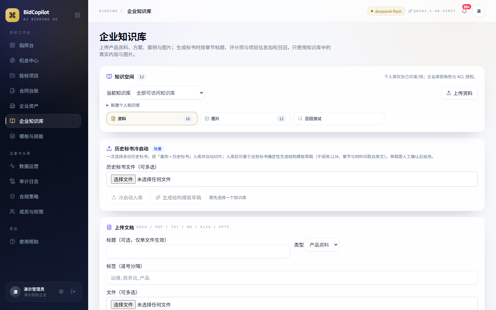

### 3.12 逐条响应 / 偏离表

- 入口：项目工作台的「逐条响应 / 偏离表」卡片。
- 覆盖：资格要求、实质性要求（自动从正文抽取含"应/须/必须/不得"等强制措辞的句子）、评分项，以及澄清/答疑里被实质改变的条款。
- 状态：待确认 / 已响应 / 偏离 / 不响应；每次变更记录确认人与时间，重建时保留既有确认。
- 操作：可按状态（含"只看未处理"）与类型筛选后批量标记，单次最多 500 条；批量与单条走同一套确认口径，若选择里混入不属于本项目的条目则整体失败，不会半生效。
- 归集：每条要求可直接关联到已生成的章节并填写证据引用（逗号分隔，失焦即保存），Excel 的「对应章节 / 证据引用」两列就来自这里；只补关联不会刷新确认时间，责任时点仍以状态变更为准。
- 闸门：仍有未处理条目时导出会被拦下并给出分项计数，确认承担风险后才强制放行，且在审计里留下强制标记。
- 边界：抽取为确定性规则，不依赖模型；与资格要求重复的实质性句子自动去重，避免同一句出现两次。
- 导出：一键导出 Excel（Summary 汇总页 + Responses 明细页），可直接作为投标文件的响应/偏离表附件。
- 价值：招标端已普遍采用机器清标，逐条可核、能说清偏离项，是进入下一轮的前提。

### 3.13 联网情报（机会中心内）

- 入口：真实工作台 `/opportunities?source=web`（机会中心「联网情报」页签），调用 `POST /api/v1/web-search`；旧 `/research` 地址 307 跳转到该页签。
- 提供方：DeepSeek `/v1/tools/search`；MiniMax Anthropic-compatible `web_search`。页签内“联网检索”卡直接展示当前提供方与是否已配置（数据来自 `GET /api/v1/system/ai-status` 的 `web_search` 字段），未配置时明确标注“未配置”而不是静默失败。
- 边界：结果只作为背景情报线索，必须人工核实后才可引用；不写入 KeepRisk 商机库，也不直接进入标书事实来源。
- 治理：每次检索写成本台账与审计链；检索结果目前不落原始快照（`opportunity_snapshots` 只服务 KeepRisk 商机），需要长期留证时先补存储设计。
- 状态：接口与页面已实现；MiniMax 真实探测返回 402 Payment Required，DeepSeek 密钥未配置时页面明确提示不可用。

**联网情报：机会中心内的真实工作台页签**

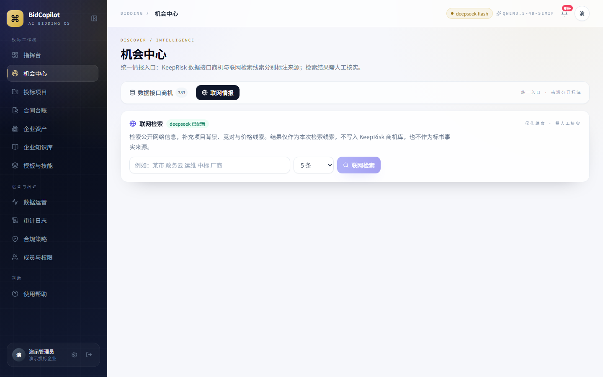

### 3.14 采购人竞争情报

- 入口：机会详情页「竞争情报」卡，点「查询采购人历史中标」触发 `POST /api/v1/opportunities/{id}/buyer-intel/sync`（权限 `opportunity:sync`），结果缓存到 `opportunity_buyer_intel`，再进页面读缓存不重复计费。
- 数据流：按采购人名称检索 KeepRisk `E_007_1271` 中标类公告（`searchKey` 按 tenderer 检索，单次取前 50 条公开记录），聚合成中标厂商榜：厂商、中标次数、近 12 个月次数、最近中标时间、累计中标额（无金额时显示"—"，不填 0）。
- 判定口径：
  - **既有供应商**：同一采购人近 12 个月内被同一厂商中标 ≥ 2 次（只数窗口内记录，不累加更早历史）。
  - **已建档**：该厂商名称命中本租户企业资产已建档企业。
  - **复盘记录过**：该厂商出现在本租户历史复盘的竞争对手文本里。
- 边界与如实标注：这是按名称匹配的启发式结果，且单次只取前 50 条，可能不完整、也可能把同名主体混在一起；界面固定写明"投标决策前请人工核实"。上游失败时保留上次成功榜单并显式标注，不用空列表覆盖。采购人未披露时明确返回 422；上游失败时状态与错误码原样落库并在界面显示，不伪造聚合结果。
- 治理：每次查询写成本台账（`opportunity.buyer_intel`）与审计（`opportunity.buyer_intel_sync`），原始响应保留快照 ref。

**采购人竞争情报：真实机会详情页**

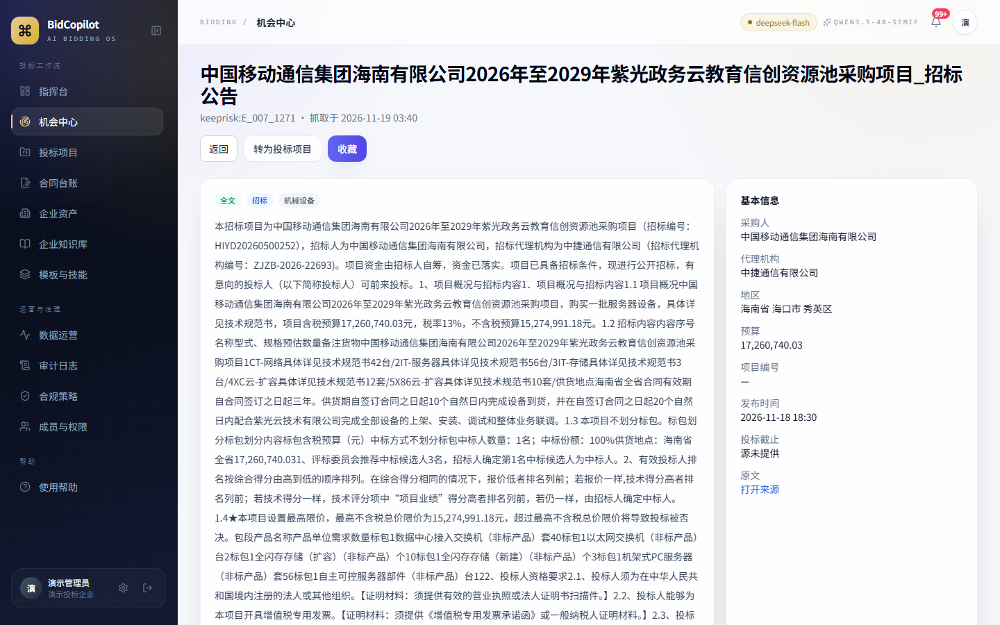

### 3.15 合同运营

- 定位：把"中标后"的合同审查与履约跟进纳入同一条证据链——合同原文不落库，切分为结构化条款后按确定性规则与（可选的）LLM 深审产出 findings，全部带条款位置与法律依据。
- 合同审查：上传合同（docx/pdf，10MB 上限）→ 按条款头切分并分类（10 类）→ 10 条确定性风险规则（履约保证金超 10%、退还条款缺失、背靠背付款、违约金上限缺失、付款条件缺失、验收标准模糊、知产/保密/争议/质保缺失）→ 与招标约束集三方对照（价格偏离 >1%、实质性要求缺口、工期事件缺口）→ findings 待确认/确认/排除。
- LLM 深审：显式触发、按次计费（写入成本台账与审计）；强制 JSON + 证据输出，**无证据结论直接丢弃**；结论不替代法务意见。
- 履约台账：自动抽取付款/交付/质保/验收四类节点（含金额），调度器每日扫描到期节点推送消息中心；到期的节点不重复提醒。
- 补充协议：上传补充协议自动对照原合同——新条款标 missing、变更条款标 deviation（high），双道防线防漏检。
- 租户自定义规则：正则模式 + 消息模板，按租户配置；每规则每次审查只记一次。
- 边界：规则为确定性匹配，不做语义级法律判断；深审 LLM 未配置时明确失败；导出报告每行附带免责声明。

### 3.16 企业情报（工商 / 信用 / 股权 / 尽调）

- 入口按对象拆分：企业资产「工商自检」（自己/集团）、机会详情「采购人企业情报」、投标项目「投标主体核验」、合同详情「合同相对方尽调」。
- 主体匹配：先用 `resolve_entity` 锚定全称，再查工商/信用/关联/尽调；公告名称不规范时不要直接查。
- 批量核验：项目内一次核验 ≤100 家，单次网关调用；未返回名称单独列出。
- 企业对比：2–5 家，输出 ranking、综合/经营/科创/财务评分与风险摘要；约 10 次调用/家。
- 监控订阅：把主体加入 watchlist，调度器按周期检查被执行/失信/行政处罚/经营异常；只有风险变化才发站内通知，每次检查按尽调节数计费。
- 计费与缓存：成本台账记录 `mcp:<tool>`、调用次数与计费单位；缓存命中 `billing_units=0`。
- 风险语义：`credit_score.risk_level` 可能为 red/unknown，而 risk_summary 仍为 green；界面原样展示并提示单家尽调，不以评分替代通过结论。
- 合规边界：只做关联关系/风险提示，不做串标定性，不提供规避建议；人员/联系方式按字段策略最小化。

### 3.17 版本形态与配额

- 社区版（BSL 1.1）：单企业自部署，不做用量配额（不限量），AI 调用配额仍由 `PAID_CALL_*` 独立控制。
- 企业版（商业授权，闭源）：平台页为租户配置套餐（项目/席位/AI 篇数/AI 字数上限与有效期，超限 429）、查看用量并治理租户生命周期；对外提供多租户/SaaS 服务需另行商业授权（见 LICENSE）。

### 3.18 交标回执

- 项目详情「合规与交付」下记录递交时间、平台、回执号与备注；保存时冻结当时的交标自查快照（总项/完成/阻断未闭环/完成率）。
- 这是**人工留痕**，系统不会自动向交易平台确认“已递交”；回执号与平台截图/回执文件仍需人工留存（附件上传待做）。
- 回执写入审计链，可追溯操作人；同一项目可多次记录（重新递交/补交）。

### 3.19 知识库冷启动与交付品牌

- 知识库页「历史标书冷启动」：一次选择多份历史标书，按「案例 + 历史标书」标签入库并自动切片，供后续生成召回；不自动生成模板，模板仍需人工整理。
- 导出品牌取项目关联企业名称（`project.company_id → Company.name`），无关联企业时回退 BidCopilot；暗标导出自动剔除品牌。项目「交付摘要」页展示项目、交标自查与最新回执，可打印/另存 PDF。
- 品牌已嵌入 docx/xlsx/PDF 导出件（`export_branding.py`）；不做弱化工具品牌的白标（企业以自身名义投标）。

### 3.20 报价决策与报价单

- 报价成本参数：项目页「更多决策工具 → 报价成本参数」卡（或 `GET/PUT /api/v1/system/pricing-settings`，需 `tenant:read` / `tenant:settings:manage`）配置直接成本率、间接费率、税率、人力岗位日单价与三档目标净利率；配置写入租户设置 `pricing_cost_model` / `pricing_target_margins`，下次策略测算生效。
- 报价策略：按本单绝对成本（人力投入 + 其他直接成本 + 间接/税）与同类历史中标价格带给出三档建议价（保守/均衡/进取），市场锚定价受成本底线与招标预算钳制，历史样本不足时退回成本加成并显式标注；附价格带、敏感性（±3/5/8%）与 LLM 策略叙述（未配置网关时降级模板）。
- 报价单：`POST /api/v1/projects/{id}/pricing/quote`（`project:write`）生成不可变快照——总价取所选档位建议价或显式报价；明细行可编辑（名称/规格/数量/单位/单价），明细合计必须等于总额（否则 422）；支持供应商名称（留空取项目关联企业）、有效期、备注；自动生成人民币大写与报价单编号（`BJ-日期-随机码`）。`GET .../pricing/quote/latest` 取最新快照；`POST .../pricing/quote/export/docx`（`project:export`）导出正式报价单（元信息表/明细表/合计/大写/盖章签字栏）。
- 口径：档位无价或不可执行（如预算低于成本底线）时如实 422 并说明原因，不静默换档；每次生成保留快照，可追溯「当时报了什么价、依据哪次策略测算」；生成与导出均写审计。

### 3.21 文件体检

- `/file-check` 提供两个页签：
  - 招标文件体检：对买方侧招标文件做确定性规则检查（指定品牌/供应商、地域限制、注册资本、成立年限、特定区域业绩/奖项、所有制限制、协会/备案门槛、主观评分、保证金比例、付款/垫资），输出高风险/中风险、原文证据与修改建议。
  - 跨投标人雷同自查：上传 2–10 份投标文件，按 4-gram Jaccard 计算两两相似度，输出高/中/低与共同片段。
- 边界：规则为提示性检查，非法律意见；相似度只做合规自查，不做串标定性、不提供规避检测建议；扫描件需先 OCR 或上传可复制文本版本。

### 3.22 产品内使用帮助

- 入口：登录后从侧边栏「帮助 → 使用帮助」进入，或直接访问 `/help`；入口不需要额外业务权限，菜单本身仍按角色显示。
- 结构：9 步主线（登录→机会→上传解析→决策→模板→生成核查→响应自查→合规导出→复盘/合同），20 个章节覆盖快速开始、工作流、权限与角色、指挥台、机会中心、投标项目、合同台账、企业资产、知识库、模板、数据运营、审计、合规策略、用户/权限治理、账号设置、状态速查、FAQ 与安全边界。
- 口径：内容按当前页面与后端校验维护，明确写出状态机、导出闸门、审批重置、权限、租户隔离和已知边界；TOC 锚点可直达章节，移动端目录折叠在「本页目录」。
- 验收（2026-11-18）：单容器镜像 `5e621053831e`；管理员与 `bid_engineer` 浏览器实测 `/help` 可达，20 个章节全部命中；帮助相关 Vitest 11 passed，`tsc --noEmit` 0。

---

## 四、技术架构与私有化

### 4.1 架构

```
Next.js 14 工作台
        │  /api 反向代理（nginx）
FastAPI 模块化单体 ── PostgreSQL（业务数据）
        │            ├─ Redis（缓存/调度触发）
        │            ├─ MinIO / 本地快照（原文与导出）
        │            └─ APScheduler（订阅同步 60s / 履约提醒 24h）
        ├─ KeepRisk 数据网关（DataResult 状态透传）
        ├─ OpenAI 兼容 LLM 网关（主模型 + judge）
        └─ 本地 OCR：MinerU 4（进程内，ONNX/CPU，tier 按显存自适应）
           云端 OCR（可选）：MiniMax VLM
```

### 4.2 部署形态

- 单容器（标准形态）：`deploy/allin1` 提供唯一部署拓扑——应用 + PostgreSQL + Redis + MinIO + nginx 全部运行在同一个容器 `bidcopilot-app` 内；本地测试与生产使用**同一镜像、同一容器名、同一 compose 文件**；唯一启动入口 `scripts/run_local_site.sh`（站点 http://127.0.0.1:18080）。镜像内含 MinerU OCR 运行时与模型（离线可用）。
- 多容器（K8s）：Helm Chart（单 Deployment 同时承载应用与前端静态资源 + Ingress + HPA + migration-job），生产集群化部署用；无独立 frontend/worker Deployment（后台执行模型仅 APScheduler + PG advisory lock 一种）。
- 离线：离线镜像包脚本（在可访问镜像源的环境构建），含镜像 tar、compose、备份脚本与 SHA256SUMS。
- 发布门禁：全新空库迁移→seed→独立 API→冒烟；非破坏性恢复校验；密钥扫描；架构/许可证/版本检查。

### 4.3 数据与安全

- 数据库迁移只前进；共享环境禁止破坏性 downgrade。
- 外部公告 HTML 白名单清洗、URL scheme 限制、正文大小限制。
- 暗标导出清空文档核心属性；审计链可检测篡改。
- 模型密钥只走环境变量/密钥管理；租户模型配置只存 base_url/model/enabled。

---

## 五、对外宣贯材料

### 5.1 30 秒话术

“BidCopilot 把招投标从‘人找文件、人写标书、人肉检查’变成一条可追溯的流水线：真实商机统一进来，招标文件自动拆成评分项和资格条件，先判断投不投，再用模板和 AI 生成、用证据核查、用 29 条规则做合规预检，最后导出普通或暗标标书，并把结果复盘成赢率；投前还能核验采购人、投标主体与合同相对方的工商/信用/股权关联。整套系统可以私有化部署，数据和模型都在您自己的环境里。”

### 5.2 2 分钟价值陈述

1. 商机与资产有真源：KeepRisk + 企业台账，不是手工 Excel。
2. 解析有结构：评分项、资格、废标、时间、预算、清单全部带原文位置。
3. 决策有口径：资格 UNKNOWN 不伪造通过，硬性 FAIL 直接 No-Go。
4. 生产有依据：规则/LLM 只使用真实资产与招标条款；事实核查逐条找来源。
5. 合规有硬规则：暗标、格式、资格、证据、清单、时间、报价异常。
6. 结果有沉淀：赢率、失标原因、调用成本可查。
7. 部署可控：多租户、RBAC、审计链、私有化。
8. 投前可核验：采购人、投标主体、合同相对方的工商/信用/股权关联；支持批量核验与企业对比，`red/unknown` 风险原样展示并提示人工尽调。

### 5.3 可量化证明（当前版本）

| 指标 | 数值 |
|---|---|
| 后端自动化测试 | 单元+集成 986 passed / 2 skipped（2026-11-17 复验；集成对真实 PostgreSQL `localhost:25432/bidcopilot_test` + Redis `6390` 实跑） |
| 前端组件测试 | 20 文件 / 69 用例全部通过（2026-11-17 复验，`docker build --target frontend` 镜像内）；`tsc --noEmit` 0 |
| 解析金标语料 | 19 份自编对抗语料（docx/pdf/txt/md），四维度 P/R 均 1.000（评分 54/54、资格 36/36、废标 22/22、预算/暗标 19 全对） |
| 确定性合规规则 | 29 条（HARD 10 / SOFT 19） |
| 本地 OCR | MinerU 4 内置镜像：扫描 PDF 首扫约 17s / 热模型约 4s，`ocr_provider=mineru`、表格结构化，文本与原文一字不差 |
| 知识库格式 | 文档 7 种（docx/pdf/txt/md/xlsx/xlsm/pptx）+ 图片 4 种（png/jpg/jpeg/webp，WebP 入库转 PNG） |
| 结构/格式模板 | 4 + 2 |
| 技能目录 | 12 项 |
| 业务表 | 迁移 head `0077_price_quotes`；业务表 78 张（社区版口径，2026-11-19 实测） |
| 企业情报 MCP | 47 个工具；批量核验 1 次/批、企业对比约 10 次/家；5000 次/日；缓存命中 0 计费 |
| 真实 AI 冒烟 | deepseek-flash 生成、SemIf 评标成功 |
| 真实 KeepRisk | 同步 20 条商机并落台账；订阅首轮 49s 内触发 |
| 发布门禁 | 空库部署冒烟、恢复校验、密钥扫描通过 |

### 5.4 演示与试用

- 静态演示站（公开只读）：
  - 平台用户视角：https://bidcopilot-demo-byz953f82hk.qoder.zone/?role=user
  - 管理员视角：https://bidcopilot-demo-byz953f82hk.qoder.zone/?role=admin
- 说明：右上角可随时切换两种视角；演示站是静态页面，数据为示例，不能登录或调用真实模型；需要真实试用时部署私有化环境。

### 5.5 常见问答

**Q：能不能直接用公网 SaaS？**
A：当前产品定位是私有化部署，数据和模型留在客户环境；静态演示站只用于看界面。

**Q：AI 会不会编造业绩/证书？**
A：规则草稿只引用真实资产与招标条款；LLM 生成后必须做事实核查，无源主张会标红；资格缺证据输出 UNKNOWN，不伪造通过。

**Q：和通用大模型写作有什么区别？**
A：通用模型只负责“写”；BidCopilot 负责“写之前的解析与决策、写之后的核查/合规/导出/复盘”，并且证据可追溯。

**Q：支持暗标吗？**
A：支持。暗标导出会替换企业/人员名称并清空文档核心属性；暗标项目才会触发元数据检查。

**Q：数据安全如何保证？**
A：多租户隔离、RBAC、审计哈希链、会话失效、密钥不入库；支持私有化与离线部署。

**Q：企业情报数据从哪来、怎么计费？**
A：经 KeepRisk 企业数据 MCP 按次调用：批量核验 1 次/批、企业对比约 10 次/家、尽调按节计费，缓存命中不计费；未配置或上游失败会原样显示状态，不伪造结果。只做关联关系/风险提示，不做串标定性。

---

## 六、内部产品培训

### 6.1 角色与权限（建议）

| 角色 | 机会 | 资产 | 项目/生成 | 合规 | 用户管理 |
|---|---|---|---|---|---|
| 企业管理员 | 全部 | 全部 | 全部 | 全部 | 全部 |
| 投标负责人 | 全部 | 读 | 全部 | 读 | — |
| 标书工程师 | 读 | 读 | 写 | 读 | — |
| 合规/法务 | 读 | 读 | 读 | 全部 | — |

实际权限以角色配置为准；敏感操作写入审计链。除 4 个系统角色外，企业管理员可创建自定义角色（能力词表校验）并按部门（org_unit）作用域授权；知识库/模板/资产另有 ACL 与字段级脱敏策略（见 3.10）。

### 6.2 首次上手 10 步

1. 登录，确认顶栏 AI 状态与租户。
2. 在“企业资产”确认企业已创建，导入资质/人员/业绩；在“企业知识库”上传产品资料、方案与图片。
3. 在“机会中心”同步或选择商机，收藏并转为投标项目。
4. 在项目详情绑定投标企业，上传招标文件。
5. 检查约束集：评分项、资格、废标、时间、预算、清单、暗标。
6. 生成评分矩阵、运行资格预审、生成 Bid-No-Bid。
7. 在“模板与技能”选择结构模板与格式模板，生成大纲。
8. 选择“规则草稿”或“LLM 生成”，编辑章节并运行事实核查。
9. 审批章节，运行合规预检并处置 findings。
10. 导出普通/暗标 docx，记录结果复盘，在数据运营核对调用成本。

### 6.3 工作台四阶段

| 阶段 | 关注点 | 阻塞条件 |
|---|---|---|
| 1 解析与决策 | 约束集、矩阵、资格、决策 | 未上传/未解析招标文件 |
| 2 模板与大纲 | 模板、章节骨架、材料四态 | 未生成大纲 |
| 3 生成与核查 | 规则/LLM 生成、事实核查、审批 | 无章节、存在未审批章节 |
| 4 合规与交付 | 合规预检、findings、导出 | 未审批、存在 HIGH findings 未处置 |

### 6.4 材料四态怎么用

- available：企业台账已匹配，可直接引用。
- unknown：有同类资产但未匹配，需人工确认。
- missing：台账没有，必须补录或放弃该评分项。
- to_write：需要新写的方案/承诺类材料。
- 知识库参考：材料名可匹配知识库文档，workspace 显示参考数量；知识文档只作参考，不改变资产状态，避免把资料当资质证据。

### 6.5 合规与策略

- 默认 29 条规则全部启用；租户可按项目类型调整启用状态、严重级别与相似度阈值（查重类规则）。
- HIGH 建议提交前必须处置；MEDIUM 需说明；LOW 可记录。
- 非暗标项目不触发暗标元数据检查；暗标项目必须用暗标导出。

### 6.6 AI 配置与排障

- 主模型与 judge 模型分别配置 base_url、model、enabled；密钥只走环境变量。
- LLM 未配置：生成返回 503 `llm_not_configured`，不静默降级。
- judge 超时：回退主模型并记录 `judge_fallback`，结果标记需复核。
- 输出非法：返回 502，不伪造评分。
- OCR 不可用（mineru 运行缺失且 MiniMax 未配置）/失败：明确失败（`ocr_failed` / 「OCR 服务未配置」），文档状态保留；本地 MinerU 首次解析含模型加载约十几秒，超时上限 `MINERU_TIMEOUT_SECONDS`（默认 300s）。

### 6.7 演示、冒烟与发布

```bash
# 仓库根目录执行（演示口令显式提供，不内置默认值；缺失时拒绝启动/报错退出）
export BIDCOPILOT_DEMO_PASSWORD='<本地演示口令>'
bash scripts/run_local_site.sh

# 演示数据（幂等）
cd backend
uv run python -m app.cli seed-demo --slug demo --email demo@example.com
uv run python ../scripts/smoke_demo.py --base-url http://127.0.0.1:8000
cd ..

# 全新空库发布门禁
uv run --project backend python scripts/fresh_db_smoke.py
# 非破坏性恢复校验
bash scripts/verify_restore.sh

# 仓库门禁
python scripts/check_architecture.py
python scripts/check_licenses.py
python scripts/check_versions.py
python scripts/check_secrets.py
```

- 演示账号由 `seed-demo` 创建；密码不写入本说明，按内部交接执行。
- 后端无热重载：改解析器/API 后必须重启再走 UI 验收，否则页面会展示旧版本（以页面上的 parser 版本为准）。

### 6.8 常见问题排查

| 现象 | 可能原因 | 处理 |
|---|---|---|
| 上传后评分项为 0 | 解析器版本旧/表格版式未覆盖 | 确认 parser 版本；补充金标语料并修规则 |
| 预算为空 | 招标未写预算或写法未覆盖 | 检查原文；补预算词表/格式 |
| 资格全 UNKNOWN | 企业资产未绑定或未导入 | 绑定企业、补录资产 |
| 事实核查大量无源 | 章节含外部知识/推算数字 | 人工复核；补来源或改写 |
| 合规 DARK-META 报错 | 暗标项目用了普通导出 | 改用暗标导出 |
| 生成 503 | LLM 未配置 | 配置模型或改规则草稿 |
| 评标 502/超时 | judge 输出非法/超时 | 检查模型；超时会回退主模型 |
| 上传扫描件解析失败 | OCR 通道不可用（`/system/ai-status` 的 ocr 字段可查 provider） | 确认镜像内 mineru 可用或配置 MiniMax |
| 页面数据不更新 | 后端未重启 | 重启 API 后刷新 |

### 6.9 培训演示脚本（30 分钟）

1. 5 分钟：定位与全景（能力地图 + 端到端流程）。
2. 5 分钟：机会→项目→上传解析（展示约束集与原文位置）。
3. 5 分钟：矩阵/资格/Bid-No-Bid（强调 UNKNOWN 不伪造）。
4. 8 分钟：模板→大纲→规则草稿→LLM 生成→事实核查→审批。
5. 5 分钟：合规预检→findings→暗标导出→复盘/赢率。
6. 2 分钟：数据运营与安全（台账、审计链、租户隔离）。

---

## 七、边界与路线图（如实）

### 7.1 已验证

- 真实 KeepRisk 同步/详情/企业情报/成本台账。
- 真实 LLM 生成与 judge 评标；端到端“解析→模板→生成→核查→审批→导出”。
- 空库部署冒烟、非破坏性恢复校验、密钥扫描、架构/许可证/版本门禁。
- 试点预检核心 PASS（2026-10-22 当时口径）：PostgreSQL 0016/35 表、Redis、本地快照、主模型/评审模型、KeepRisk、MiniMax 配置。当前为 head 0077 / 79 表。
- 单容器演示镜像端到端通过：登录→约束→5 章节审批→合规→xlsx/docx 导出→赢率/数据运营；未配置搜索密钥时明确 503。
- 离线包 `bidcopilot-offline-0.1.0-final4.tar.gz`（468MB，2026-10-22 构建，MinerU 替换前的旧包）生成并校验；`docker load` 加载 8 个镜像后，标准 Compose 栈完成 seed 与端到端冒烟。过程中修复前端运行时缺 pnpm、nginx `/healthz` 路由及备份/恢复脚本 Windows 路径转换三处部署缺陷。
- 标准 Compose 下 MinIO 首次上传自动建桶，对象读取与删除清理均实测通过；不再需要 `minio-init`。
- 本地隔离 Compose 项目完成备份→覆盖式恢复→端到端冒烟；测试卷已删除，原标准栈恢复运行。
- 联网搜索网关：DeepSeek `/v1/tools/search` 已真实验收（配置 `DEEPSEEK_SEARCH_API_KEY` 后返回 5 条政府站点结果并写入成本台账与审计）；MiniMax Anthropic-compatible `web_search` 契约已实现，真实端点返回 402，证明网络/认证可达但账号未充值。检索结果目前不落原始快照（`opportunity_snapshots` 只服务 KeepRisk 商机），需要长期留证时要先补存储设计。
- 解析金标 19 份、合规 29 条、模板 6 套、技能 12 项。
- CSV/XLSX 资产导入与幂等；暗标元数据清洗；策略覆盖往返。
- **MinerU 本地 OCR（2026-10-24）**：镜像构建 exit 0（模型 bake 41.9s，819MB，`models verify` ok）；上传扫描 PDF 首扫 16.7s / 热模型 3.8s，`ocr_provider=mineru`、`ocr_structure_used=true`，资格 4 条/预算 480 万/评分项文本与原图一字不差；后端 257 passed / 3 skipped。

### 7.2 未完成/受限

| 项 | 状态 | 影响 |
|---|---|---|
| 客户 24 份真实金标语料 | 未取得 | 当前 F1 仅代表自编语料 |
| 知识库扫描件/向量检索 | 本地 OCR 已内置，但知识库摄取尚未接 OCR 通道，扫描 PDF 暂不支持入库；网关 `/v1/embeddings` 返回 500 not implemented | 扫描 PDF 暂不入库；召回为关键词/IDF，未引入向量 |
| MiniMax 云端 OCR 成功路径 | 本地 MinerU OCR 已实测成功（默认供应商）；MiniMax 云端通道余额不足（1008） | 云端备选路径仅验证失败路径 |
| MiniMax web_search / 外部联网检索 | 网关已接入；MiniMax 真实请求返回 402 Payment Required，DeepSeek 密钥未配置 | 可调用但未开通计费/密钥；结果仅作情报线索，不进入标书事实来源 |
| MinerU VLM 档（standard tier） | 当前镜像为 CPU 构建，`auto` 恒收敛 basic 档 | VLM 质量路线需 CUDA 构建变体并 bake 对应模型 |
| Docker 镜像/离线包 | 标准单容器镜像（含 MinerU，5.14GB）已构建校验；`dist/` 内 468MB 离线包为 2026-10-22 旧构建（MinerU 替换前） | 现场仍需加载镜像与配置真实密钥；离线包需重新构建 |
| MinIO/覆盖式恢复演练 | 本地隔离 Compose 项目已完成备份→覆盖恢复→冒烟 | 生产环境执行仍需客户授权与维护窗口 |
| 客户试点（M4） | 未开始 | 无真实客户反馈 |
| 代码提交/推送 | 主体工作已提交；2026-11-17 报价单闭环/审计链修复/文档一致性修正三个 commit 在本地 `public` 分支，推送待授权 |

### 7.3 下一步建议

1. 导入客户 24 份真实标书，按金标方法标注并记录真实指标。
2. 知识库摄取接入本地 MinerU OCR 通道，支持扫描版 PDF 入库。
3. 授权后提交权限治理波与 MinerU 替换，并重建离线包。
4. 如需 VLM 档解析质量，构建 CUDA 镜像变体并 bake standard 档模型。
5. 经授权完成 MinIO/覆盖式恢复演练。
6. 启动 2–3 家客户试点，按 P5 清单验收。

---

## 八、术语表

| 术语 | 含义 |
|---|---|
| 约束集 | 从招标文件解析出的结构化要求集合 |
| 评分矩阵 | 评分项 × 企业证据 × 章节响应的覆盖关系 |
| Bid-No-Bid | 是否投标的决策结论 |
| 事实核查 | 对正文中的可验证主张逐条找来源 |
| findings | 合规预检发现的问题项 |
| 四阶段 | 解析与决策、模板与大纲、生成与核查、合规与交付 |
| 材料四态 | available / unknown / missing / to_write |
| 暗标 | 隐去投标人身份信息的评审方式 |
| DataResult | 外部数据网关的统一结果与状态 |
| traceability | 主张可追溯到来源的比例 |
