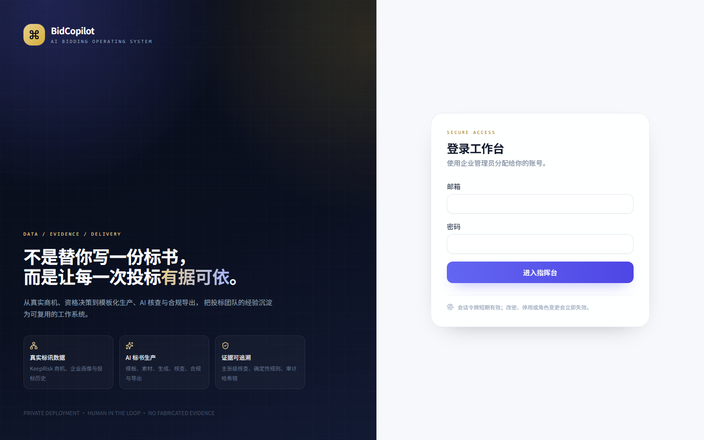
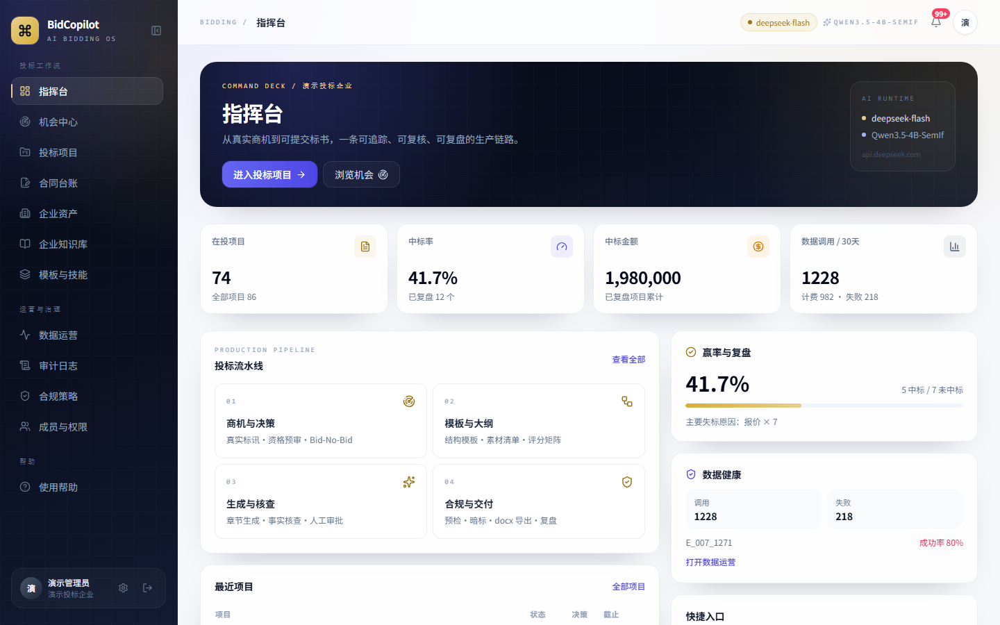
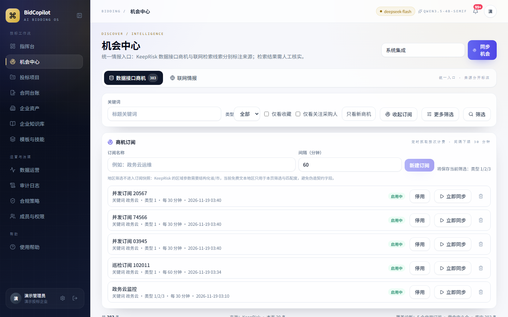

## 30 秒了解 BidCopilot

**BidCopilot** 是一个开源的 AI 投标决策与交付平台（Apache-2.0），把投标团队最重的四件事——盯商机、读招标文件、写标书、查合规——做成了一条可追踪、可复盘的生产链路。

- 公开演示（只读，真实界面）：https://bidcopilot-demo-byz953f82hk.qoder.zone/
- GitHub 源码：https://github.com/xrzlizheng/BidCopilot
- 私有化部署：一条命令 `bash scripts/run_local_site.sh`



## 公开演示里能看到什么

演示站复刻真实产品界面（数据为示例，只读，不提供登录与实时 AI 调用）：

- **指挥台**：在投项目、中标率、中标金额、数据调用一屏总览；
- **机会中心**：商机列表、订阅管理、联网情报，数据接口商机与网络线索分页签展示；
- **竞争情报**：采购人历史中标聚合、既有供应商识别；
- **合规预检**：规则命中清单、级别、期望/实际对照与处置建议；
- **知识库、企业资产、模板技能**等模块的完整界面走查。



真实能力需私有化部署，本地跑起来即可接入自己的数据。

## 投标团队的四座大山

1. **盯商机**：政府采购、国企招标、各类采购平台分散在几十个网站，靠人肉刷，漏一次标等于丢一个单；
2. **读招标文件**：动辄两三百页，资格条款、评分细则、废标条款埋在正文里，漏看一条就是废标；
3. **写标书**：技术方案、商务偏离表、逐条响应反复套历史文档；
4. **防废标**：暗标泄露身份、格式不符、响应性遗漏——每一项都是沉没成本。

## 七大功能

### 1. 商机发现

多来源商机统一接入；订阅关键词后定时自动同步，新商机进消息中心。



竞争情报能直接扒出"这个采购人最近谁中的标、中了几次、都是谁在供"——摸清战场再决定投不投。


### 2. 招标文件解析

docx / PDF / 图片 / 扫描件全支持：有文字层直接解析，扫描件走 OCR（本地 MinerU 4，ONNX 纯 CPU 离线跑；或 MiniMax 云端，自动切换）。解析产出结构化"约束集"：资格条件、评分项、实质要求、预算金额。19 份对抗语料上四维度 micro P/R 全部 1.000。

### 3. 标书生成

按招标文件生成章节大纲与正文，所有事实性内容必须来自招标文件或企业资产库，生成后自动事实核查；导出 docx 时暗标模式自检文档元数据，闸门拦截身份信息泄露。

### 4. 合规预检

29 条确定性规则逐条扫——暗标身份泄露、正文字体、资格遗漏、响应性、报价一致性、工作量成本与保证金上限……命中项带法规依据与修改建议；标书支持跨章节、跨知识库查重。


### 5. AI 评标模拟

用独立的 Judge 模型按评分项给己方标书预演打分，提前知道会丢在哪。

### 6. 合同审查

条款自动切分，10+ 风险规则（履约保证金比例、背靠背付款、违约金上限……每条挂法律依据），再做招标文件 ↔ 投标承诺 ↔ 合同三方一致性对照。

### 7. 复盘与运营

中标/失标记录、赢率分析、成本对账、审计哈希链；多租户隔离 + RBAC。

## 技术栈

- 后端：FastAPI 模块化单体，SQLAlchemy 异步 + PostgreSQL，Alembic 迁移（54 张业务表），APScheduler 定时任务 + PostgreSQL advisory lock 多实例互斥
- 前端：Next.js 14 App Router
- 存储：MinIO / S3 兼容；Redis 缓存与限流
- OCR：MinerU 4（镜像内 bake 模型，离线可用）+ MiniMax 云端
- 质量：后端 280 个测试，架构/许可证/密钥/版本四道 CI 门禁

## 部署：一个镜像，三种形态

全仓只有一个镜像，三种交付形态共用：

- **单机**：docker compose 一把梭，应用 + PostgreSQL + Redis + MinIO + nginx 同容器
- **数据层分离**：应用连外部/托管数据库，VM 部署或 SaaS 数据层用法
- **K8s**：Helm Chart，多副本调度器互斥由 advisory lock 保证

```bash
git clone https://github.com/xrzlizheng/BidCopilot.git
cd BidCopilot
bash scripts/run_local_site.sh
# 打开 http://127.0.0.1:18080
```

## 商机数据网关

解析、生成、合规、合同审查全功能本地可用；商机发现走 KeepRisk 付费网关（需要 AppCode），演示站已接入，可以先体验再决定。开通方式见 GitHub README 内的微信二维码。

## 最后

如果这个项目对你有启发，欢迎去 GitHub 点个 Star：
https://github.com/xrzlizheng/BidCopilot

部署、网关开通、行业适配相关的问题，欢迎交流。
